# FlexSfM Studio

**Structure-from-motion workbench for video and photos.** It produces camera poses and point clouds ready for
Gaussian splatting (3DGS), NeRF or photogrammetry. Footage can come from a phone, a handheld camera, a drone or a
vehicle. It uses FlexGlue matching and COLMAP/GLOMAP reconstruction, can georeference with GPS or ground markers, and
finds and repairs doubled passes. Every step runs sanity checks and saves figures you can inspect.

Video or images in, Gaussian-splat-ready data out. You run it one step at a time and can see what each step did.

<p align="center">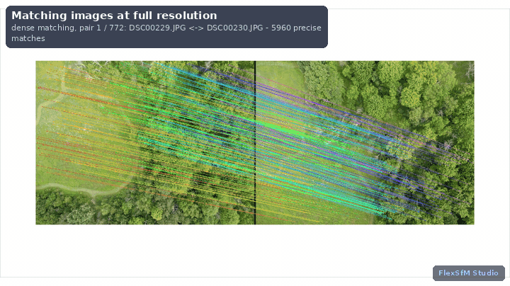</p>
<p align="center"><sub>The whole run on the public-domain <a href="#try-it-with-the-demo-data">aukerman</a> photos (SIFT + ALIKED keypoints, dense step at 24,000 keypoints per image: 367,000 points). Every view is a live panel of the app.</sub></p>

* **Opens any intermediate output:** frames, keypoints, every matched pair, each model, and its error on every frame.
* **Checks every step and says how to fix failures:** a failed check names the setting to change and the step to re-run.
* **Works with or without GPS:** photo EXIF, a CSV of positions, DJI `.SRT` subtitles, or no GPS at all. Ground control points and scale bars
  can be clicked in the app.
* **Finds and repairs doubled passes:** these appear when a place is captured twice (out and back, a loop, two
  sessions) and the two passes are never tied together. FlexGlue matches views from opposite directions, and a held-out test decides whether the repair is kept.
* **Reports how precise the points are:** imprecise tracks are what make splats soft. Defaults are tuned for sub-pixel
  tracks (see [Accuracy](#accuracy)).
* **Two ways to run it:** a desktop app (PySide6) and a command line, with the same steps and outputs.

---

## How it works

<p align="center">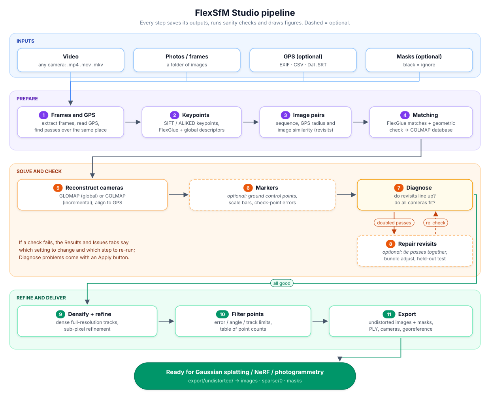</p>

Each step runs the same way:

<p align="center">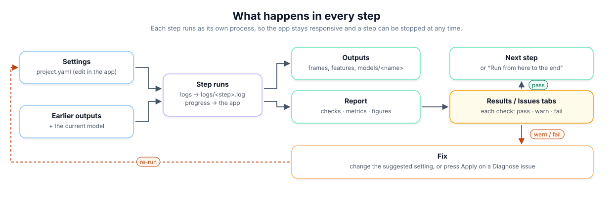</p>

Each step keeps its settings and records the outcome, so the app can show when a step is **stale**: its settings
changed, or a step it depends on was run again. The **current model** is the set of cameras that steps 6–9 start from.
Steps 5, 6 and 8 each write a new model and make it current, and you can switch back to any earlier model at any time.

---

## Tour

All screenshots are from the public-domain demo dataset (see [Try it](#try-it-with-the-demo-data)): 77 drone photos with GPS
in EXIF, run through all steps on one machine.

| | |
|---|---|
| 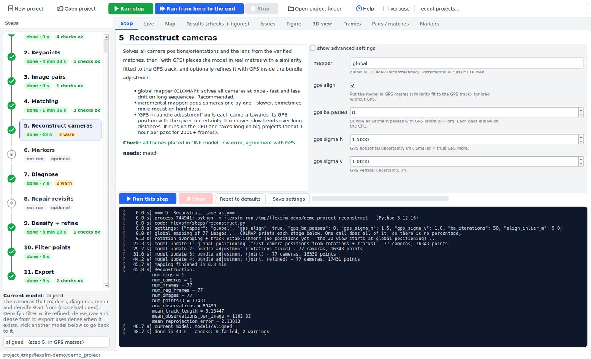<br>**Steps:** a timeline of the 11 steps, each with its settings, description and live log. | 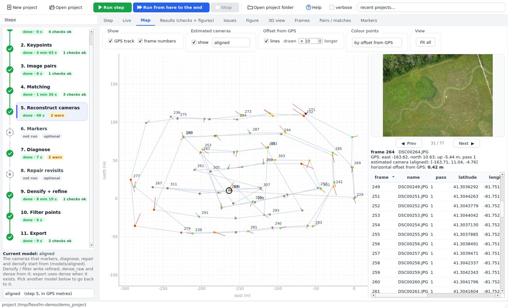<br>**Map:** GPS track with photo numbers, estimated cameras and their offset from GPS, the photo and a camera table. |
| 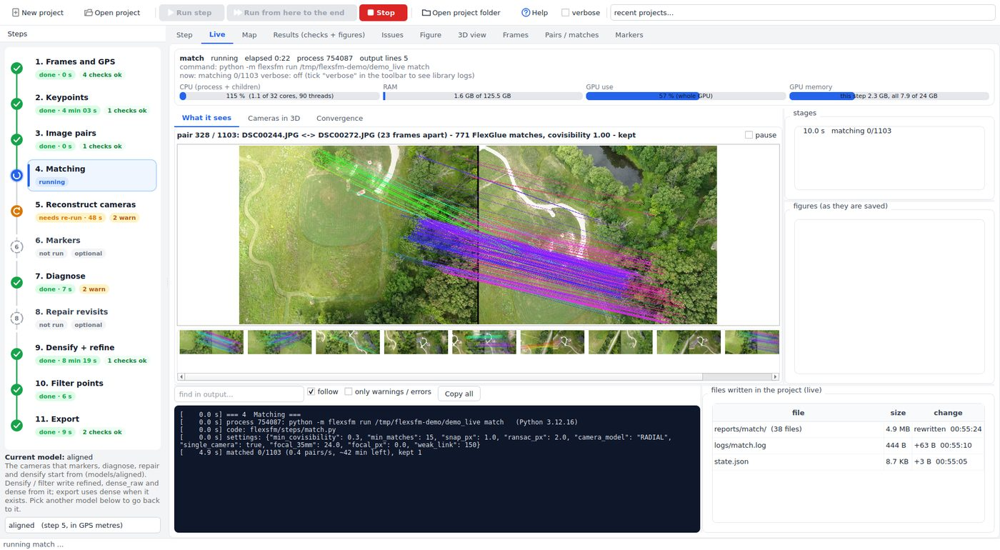<br>**Live, what it sees:** the pair being matched right now, with its match lines and the decision. | 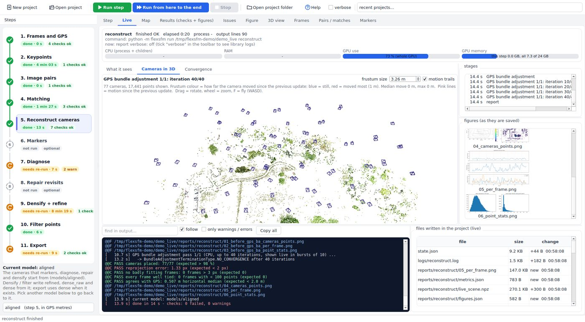<br>**Live, cameras in 3D:** frustums moving while bundle adjustment runs, coloured by how far they moved. |
| 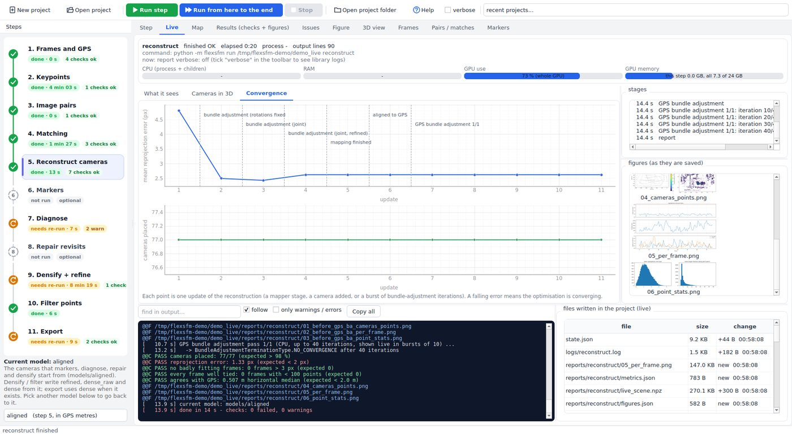<br>**Live, convergence:** reprojection error after every mapper stage and bundle-adjustment burst. | 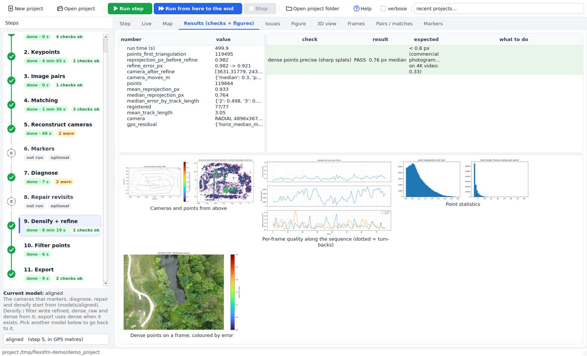<br>**Results:** the numbers, pass / warn / fail checks with what to do, and figures for every step. |
| 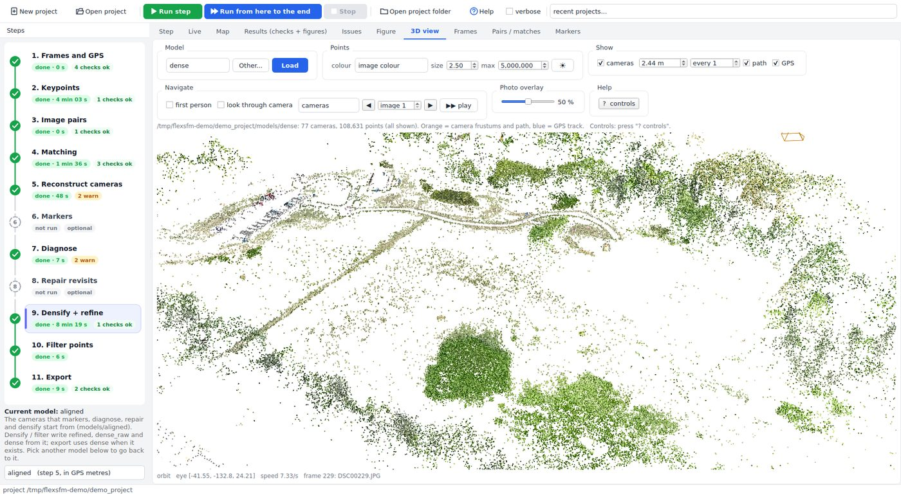<br>**3D view:** the RGB point cloud, camera frustums, camera path and GPS track. | 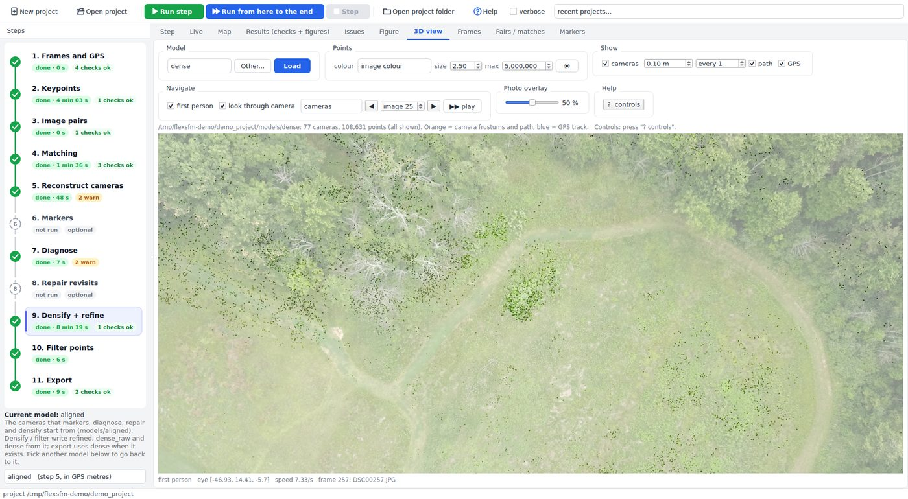<br>**Look through camera:** stand where a photo was taken; the photo overlay shows how well the points line up. |
| 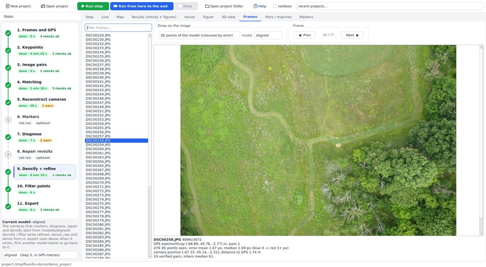<br>**Frames:** any image with its keypoints, mask, or the model's points coloured by reprojection error. | 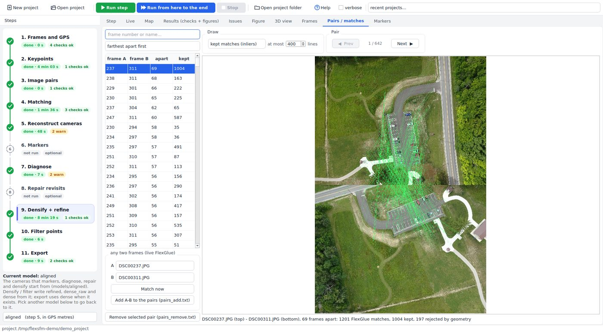<br>**Pairs / matches:** every verified pair with kept and rejected matches, and live FlexGlue on any two images. |

## Try it with the demo data

```bash
./scripts/get_demo_data.sh                    # OpenDroneMap "aukerman": 77 photos with GPS, CC0 (~520 MB) -> demo_data/aukerman
flexsfm new demo_project --source demo_data/aukerman/images --gps_source exif
./flexsfm.sh gui demo_project                 # press "Run from here to the end" and watch the Live tab
```

On one desktop GPU the whole run takes about 10 to 15 minutes, most of it in Keypoints and Densify. All 77 cameras are
placed in one model, 0.56 m from GPS (median). The dense points end at 0.76 px median reprojection error, with about
109,000 points after filtering.
For a denser cloud, like the one in the animation above, set Keypoints `detector` to `sift+aliked` (`max_keypoints` 8000)
and Densify `detector` to `sift+aliked`, `max_keypoints` 24000, `min_pair_inliers` 15, `refine_points` 1000000.
That run takes about 11 minutes and keeps 367,000 points after filtering (3.4× more). The trade-off is precision:
median reprojection error before filtering is 1.0 px instead of 0.76 px, and GPS agreement is about the same (0.57 m).
The dataset is by OpenDroneMap ([odm_data_aukerman](https://github.com/OpenDroneMap/odm_data_aukerman)), public domain
(CC0 1.0).

## Install

Works on any 64-bit Linux (Ubuntu, Debian, Fedora, Arch, ...). Root is not needed.

```bash
git clone https://github.com/Jaykumaran/FlexSfmStudio.git
cd FlexSfmStudio
./install.sh          # add --cpu to force the CPU build of PyTorch
```

The installer:

1. finds Python 3.10 or newer. If there is none, it fetches one with [uv](https://docs.astral.sh/uv/) into your home
   folder.
2. creates `./.venv`.
3. installs the PyTorch build that matches your NVIDIA driver (CUDA 12.8 / 12.6 / 11.8), or the CPU build.
4. installs FlexSfM Studio with [FlexGlue](https://github.com/cvg/FlexGlue), [LightGlue](https://github.com/cvg/LightGlue),
   [pycolmap](https://github.com/colmap/colmap) (COLMAP + GLOMAP) and a bundled `ffmpeg`.
5. runs `flexsfm doctor`.

`flexsfm doctor` checks everything (GPU, COLMAP, FlexGlue, ffmpeg, Qt, OpenGL, free disk). For anything missing it
prints the exact command that fixes it. Run it again at any time with `.venv/bin/flexsfm doctor --full`.

**Requirements:** `git`, and `curl` only if uv has to be fetched. An NVIDIA GPU is recommended; on a CPU everything
works, only slower. The desktop app needs the usual X11/Wayland libraries. On a minimal Ubuntu system the doctor may
ask for `sudo apt install libxcb-cursor0 libgl1 libegl1`.

<details><summary>Manual install</summary>

```bash
python3 -m venv .venv && source .venv/bin/activate          # Python >= 3.10
pip install torch torchvision --index-url https://download.pytorch.org/whl/cu128   # or cu126 / cu118 / cpu
pip install -e ".[gui]"
flexsfm doctor
```
</details>

## Start

```bash
./flexsfm.sh                       # desktop app (uses ./.venv, or $FLEXSFM_VENV, or the python on PATH)
./flexsfm.sh gui /path/to/project  # app with a project open
```

From the command line, the same steps write the same outputs:

```bash
flexsfm new  myproj --source DJI_0001.MP4                      # the .SRT next to the video is found automatically
flexsfm new  myproj --source frames/ --srt DJI_0001.SRT --step 15
flexsfm new  myproj --source photos/ --gps_source exif         # or: csv / none
flexsfm all  myproj                                            # run the standard steps in order
flexsfm all  myproj --with repair                              # include an optional step
flexsfm run  myproj densify --set max_keypoints=20000          # one step, with a setting changed
flexsfm status myproj
```

Projects need room, about 2–3× the size of the frames, so put them on a large disk.

## The app

| Panel | What it shows |
|---|---|
| **Steps** (left) | A timeline of the 11 steps. Each shows its status (done, running, needs re-run, failed, interrupted, not run), how long it took and how many checks passed, warned or failed. The running step pulses; the selected one is highlighted. Below it is the **current model** and a list of every model so you can go back to one. |
| **Live** | Watch a step work. **What it sees:** the image or pair being processed right now, such as keypoints appearing on each image, the current pair with its match lines, and revisit pairs during repair, with a filmstrip to look back. **Cameras in 3D:** the reconstruction as it forms. Frustums appear at global positioning (or one by one with the incremental mapper), then move during each bundle adjustment, coloured by how far they moved with motion trails. **Convergence:** the reprojection error after every update. Also shows the command, process id, CPU/RAM/GPU use, the raw output (searchable, warnings and errors coloured), every file written and each figure. Previews are drawn in the background and do not slow the step. It also follows steps started from the command line. Tick **verbose** for all COLMAP / GLOMAP / Ceres logs (`FLEXSFM_VERBOSE=1`). Turn previews off with `FLEXSFM_LIVE=0`. |
| **Step** | What the step does, its settings (hover for help; tick *show advanced* for more), *Run this step* / *Run from here to the end*, progress with time left, and the live log. |
| **Map** | Right after import: the GPS trajectory (or the estimated cameras without GPS) in plan view, coloured by pass, frame, height or offset, with frame numbers (more appear as you zoom). Hover a point for its details; click it for the image preview. Estimated cameras are drawn with offset lines to their GPS position, and a camera table lists latitude, longitude, altitude and offset. |
| **Results** | Numbers, checks (green, yellow or red, each with what to do), and figures. Click a figure to zoom in. |
| **Issues** | Every check that did not pass, from all steps. Problems found by Diagnose come with an **Apply** button that sets the suggested settings and runs the fix. |
| **3D view** | Any model, or another COLMAP model such as a Metashape export. Colour points by image colour, error, track length or height. Shows the cameras as frustums (adjustable size), the camera path and the GPS track. **First person:** fly with W/A/S/D, Q/E (down/up), Shift (faster) and mouse drag (look). Jump into any estimated camera or GPS position, step with `[` `]`, or *play* the whole trajectory. |
| **Frames** | Any frame with its keypoints, dense keypoints, mask, or the model's points coloured by reprojection error. Also shows its GPS, its distance to GPS and how many pairs it has. |
| **Pairs / matches** | Every verified pair, with kept and rejected matches drawn. **Match now** runs FlexGlue live on any two frames. Add or remove pairs by hand. |
| **Markers** | Click ground control points. After 2 clicks the marker is predicted in every other image. |

## Steps and outputs

| # | Step | Writes | Look at |
|---|---|---|---|
| 1 | Frames and GPS | `frames/`, `images.txt`, `gps.npz` | GPS track with frame numbers, passes, height and spacing |
| 2 | Keypoints | `features/*.kp.npy, *.pt, *.g.npy`, `globals.npy` | keypoints per frame, weakest frame, similarity matrix |
| 3 | Image pairs | `pairs.txt` (`pairs_add.txt` / `pairs_remove.txt` are yours to edit) | pair matrix by source, pairs per frame |
| 4 | Matching | `database.db`, `pair_inliers.npz` | **link strength**: where the model could break |
| 5 | Reconstruct cameras | `models/initial`, `models/aligned` | cameras vs GPS, top view, error per frame |
| 6 | Markers *(optional)* | `models/markers`, `markers_result.json` | control / check point errors, click vs projection |
| 7 | Diagnose | `issues.json` | **revisit check** (doubled lanes), misalignment map, rolling-shutter check |
| 8 | Repair revisits *(optional)* | `models/repaired`, `repair_pairs.txt` | before/after on held-out pairs, camera moves |
| 9 | Densify + refine | `features_dense/`, `models/refined`, `models/dense_raw` | precision: median error, error by track length |
| 10 | Filter points | `models/dense` | points kept for every setting |
| 11 | Export | `export/undistorted/{images,sparse/0,masks}`, `export/points.ply`, `cameras.csv`, `georef.json` | comparison with another model |

Every step also writes `reports/<step>/` (figures, `checks.json`, `metrics.json`) and `logs/<step>.log`.

**For Gaussian-splat training, use `export/undistorted/`.** It has pinhole cameras, `images/`, `sparse/0/` and `masks/`.

## Problems and fixes

| What you see | Where | Fix |
|---|---|---|
| Frames not placed, or several models | step 5 checks; dips in step 4 *link strength* | Step 3: raise `sequential` (8 → 12). Step 4: lower `min covisibility`. Re-run 3 → 5. |
| Doubled surfaces or ghosting where the capture passes again | step 7: *revisits line up* fails | Run step 8. If the repair is not adopted, raise `pairs per image` / `footprint m`. |
| Soft splats, doubled signs or edges | step 9: *dense points precise* warns | Use detector `sift`, `snap px` 0.7, `ransac px` 1.0, `track px` 1.5 (the defaults). |
| Too few points for training | step 10 table | Pick a looser filter row, or raise step 9 `max keypoints` (16000 → 24000). |
| Model bends away from GPS over long distances | step 5: *distance to GPS* grows with distance | Step 5: set `gps ba passes` to 1. |
| GPS altitude is useless (all 0) | step 1 | Tick `ignore gps altitude`. |
| No GPS | step 1 warns | This is fine. For metres and orientation, use step 6 with 3+ known markers, or 2 markers and a distance. |
| Weak frames (blur, sky) | step 2 | Look at them in *Frames*; add masks, or ignore them if there are few. |
| Many pairs rejected by geometry | step 4 | Possibly rolling shutter or lens distortion: raise `ransac px` a little, or try camera model `OPENCV`. |

## Accuracy

These numbers were measured on 4K drone video of a 2 km road corridor (2,354 frames). Other cameras and scenes will
give different values, and each project's checks report its own.

* A commercial photogrammetry package's tie points have a mean reprojection error of 0.45 px (median 0.33 px).
* FlexGlue with ALIKED keypoints and FlexGlue's default 3 px snapping gives 1.5 px. Its tracks mixed up neighbouring
  points, which shows up as doubled edges in splats.
* SIFT at full resolution, 0.7 px snapping, a 1 px geometric check and strict track building give a median of 0.53 px
  with *more* points. These are the defaults.
* Rolling shutter was measured and did not show in the residuals at normal survey speeds. Step 7 checks it for every
  project.
* On outbound vs return passes (opposite viewing directions), FlexGlue finds 55–112 inliers per pair, against 13–17
  for LightGlue/SIFT. Step 8 relies on this.

## Limits

* Bundle adjustment runs on the CPU, because the pycolmap wheels are built without CUDA. A GPS-weighted adjustment of
  2,000+ frames takes about an hour per pass.
* There is no rolling-shutter camera model (COLMAP has none).
* The 3D view needs OpenGL 2.1 or newer. On headless or remote sessions, open `export/points.ply` in another viewer.

## Licence

FlexSfM Studio is released under the [Apache License 2.0](LICENSE). It uses third-party projects under their own
licences; see [THIRD_PARTY.md](THIRD_PARTY.md). **Note:** FlexGlue's backbone weights are derived from DINOv3 and
come under Meta's [DINOv3 License](https://ai.meta.com/resources/models-and-libraries/dinov3-license). Review it
before commercial use.

## Acknowledgements

FlexSfM Studio builds on [FlexGlue](https://github.com/cvg/FlexGlue), [LightGlue](https://github.com/cvg/LightGlue),
[COLMAP](https://colmap.github.io) and [GLOMAP](https://github.com/colmap/glomap). If you use it in research, please
cite those projects.
